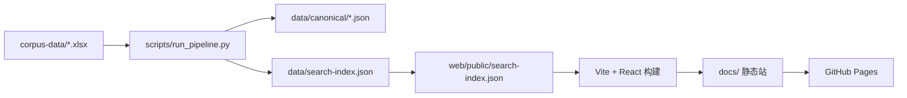

# Parallel Learner Corpus

中日双语平行学习者语料库（Demo）：浏览器端静态检索站点，可部署到 GitHub Pages。

- 在线示例（若已开启 Pages）：https://wd-github-2017.github.io/parallel-corpus/
- 源码仓库：https://github.com/wd-github-2017/parallel-corpus

---

## 目录

1. [功能](#功能)
2. [架构](#架构)
3. [数据约定](#数据约定)
4. [检索语义](#检索语义)
5. [仓库结构](#仓库结构)
6. [本地开发](#本地开发)
7. [如何更新语料数据](#如何更新语料数据)
8. [实际维护实例（2026-08）](#实际维护实例2026-08)
9. [如何重新部署 / 发布](#如何重新部署--发布)
10. [日常维护清单](#日常维护清单)
11. [后续扩展（服务器版）](#后续扩展服务器版)

---

## 功能

### 检索

| 能力 | 说明 | 示例 |
|------|------|------|
| 作文语种 | 日语作文 / 汉语作文 | `group=zh_jp` → L2=日语；`jp_zh` → L2=汉语 |
| 用法筛选 | 全部 / 正确 / 错误 | 错误用法匹配语病「修改前」 |
| 单词语 / 形态素 | 整 token 精确匹配；连续串可映射到覆盖 token | `趣味`、`日本語` |
| 多词语共现 | 同句内有序匹配，默认中间可插 ≤2 个 token | `吃 米饭` |
| 词性 / 混合模式 | `+` 连接 form 或 POS（中日别名或 UPOS） | `動詞+名詞`、`興味+動詞`、`看+名词` |
| 上下文 | 可设命中句前 N / 后 M 句 | 默认各 1 句 |
| 结果单位 | 以**句子**为单位展示 | 高亮命中 token；展示平行 L1 与语病徽章 |

### 界面与导出

- **界面语言**：日本語 / 中文 / English（首次按系统语言自动选择；手动切换写入 `localStorage`）
- **下载全部语料 CSV**：句级全库导出
- **下载检索结果 CSV**：仅当前命中句（含查询条件、通道、上下文等）
- CSV 编码均为 **UTF-8 with BOM**（`U+FEFF`），便于 Excel 正确显示日文/中文

### 设计

检索 UI 视觉参考 [`resource/DESIGN-meta.md`](resource/DESIGN-meta.md)（Meta 设计 token：白底、胶囊控件、黑主按钮等）。

---

## 架构

本 Demo **无后端**：构建期把 Excel 加工成 JSON 索引，运行时在浏览器内完成检索。



### 分层说明

| 层 | 技术 | 职责 |
|----|------|------|
| 源数据 | Excel（`.xlsx`） | 人工标注与平行句；项目输入真源之一 |
| 预处理管线 | Python（SudachiPy / jieba） | 分句、解析语病、**仅对 field 分词+UPOS**、对齐、建索引 |
| 权威语料 | `data/canonical/*.json` | 按篇结构化存储（句、token、errors） |
| 检索索引 | `search-index.json` | 前端加载的句序列 + 倒排辅助字段 |
| 前端 | Vite + React + TypeScript | 查询解析、双通道检索、UI、CSV 下载 |
| 分发 | `docs/`（或 `github-pages/`） | 预构建静态文件，供 Pages 直接托管 |

### 双通道数据模型（核心）

| 通道 | 数据来源 | 用途 |
|------|----------|------|
| **field** | `text_l2-field` / `text_l1-field` | **唯一**分词与词性对象；词形/共现/POS 检索；结果主展示文本 |
| **marked（语病）** | `text_l2-marked` | **不参与分词**；解析 `【修改前\|类型\|修改后】`；错误用法检索 |

构建时用语病的「修改后」在 `l2_field` 上定位，得到 `after_token_ids`，用于「正确用法」排除纠错位点。

### 前端检索流程（运行时）

1. 加载 `/search-index.json`
2. 解析检索式（空格共现 / `+` 槽位）
3. 按语种过滤句子
4. 用法 = 错误 → 匹配语病「修改前」；用法 = 正确 → field 命中且非纠错位点；用法 = 全部 → 两通道并集
5. 拼装前后文、高亮、可选导出 CSV

---

## 数据约定

### Excel 主要列

| 列名 | 含义 |
|------|------|
| `No-essay` | 作文 ID |
| `group` | `zh_jp`（L2=日语）或 `jp_zh`（L2=汉语） |
| `year` / `level` / `notes` | 元数据 |
| `text_l2-field` | L2 按句切分：`\sentenceNN{...}` |
| `text_l1-field` | L1 平行句：`\sentenceNN{...}` |
| `text_l2-marked` | L2 语病标注句：`\markedNN{...}` 或 `/markedN{...}` |
| `essay-raw` / `text_l1` | 全文备份（不进入主检索路径） |

### 语病标注格式

```text
【修改前|错误类型|修改后】
例：【趣味|wrong-content-word|興味】
```

- `∅` 表示空（缺省或多余被删）
- 解析器兼容 `\marked01{...}` 与 `/marked1{...}` 等写法

### 语言学标注

- 日语：Sudachi **A 单位**（短单位 / 形态素级），POS 映射到 UD **UPOS**
- 汉语：jieba 分词+词性 → UPOS
- 例：「日本語」常被切成「日本」(PROPN) +「語」(NOUN)；连续检索串会按表面子串映射到覆盖的 token

### 权威产物

- `data/canonical/<essay_id>.json`：单篇完整结构  
- `data/search-index.json`：全库检索索引（并复制到 `web/public/`）

---

## 检索语义

| 筛选 | 行为 |
|------|------|
| **错误** | 查询匹配该句语病条目的 **修改前**（可对修改前再分词做模式匹配） |
| **正确** | 在 `l2_field` token 序列上命中，且命中 token **不是**「修改后」对齐到的纠错位点 |
| **全部** | field 通道与误用通道的**并集** |

词性别名示例：名词/名詞/NOUN、动词/動詞/VERB、形容词/形容詞/ADJ、副词/副詞/ADV、助词/助詞/PART 等。

界面内「检索示例」已按当前样例数据实测；点击可自动填入条件并检索。

---

## 仓库结构

```text
parallel-corpus/
├── corpus-data/                 # 原始 Excel（更新语料从这里开始）
├── scripts/                     # 预处理管线
│   ├── run_pipeline.py          # 一键：Excel → canonical → search-index
│   ├── ingest_xlsx.py           # 分句 + 解析语病
│   ├── annotate_tokens.py       # 仅对 field 分词+UPOS + 修改后对齐
│   ├── build_index.py           # 生成 search-index.json
│   └── pos_map.py               # POS → UPOS / UI 别名
├── data/
│   ├── canonical/               # 权威 JSON（每篇一文）
│   └── search-index.json        # 检索索引
├── web/                         # Vite + React 源码
│   ├── public/search-index.json # 开发/构建时由管线同步
│   └── src/                     # UI、i18n、search、CSV 导出
├── docs/                        # GitHub Pages 当前发布目录（/docs）
├── github-pages/                # 同内容分发包备份（可复制到 docs）
├── resource/DESIGN-meta.md      # UI 设计参考
├── requirements.txt             # Python 依赖
├── .github/workflows/deploy.yml # 可选：Actions 自动构建部署
└── README.md
```

---

## 本地开发

### 环境要求

- Python 3.10+（推荐 3.12）
- Node.js 20+（前端）

### 1. Python 管线

```bash
cd parallel-corpus
python3 -m venv .venv
source .venv/bin/activate          # Windows: .venv\Scripts\activate
pip install -r requirements.txt
python scripts/run_pipeline.py
```

成功后应看到 `data/canonical/*.json` 与 `data/search-index.json`，并同步到 `web/public/search-index.json`。

### 2. 前端开发服务器

```bash
cd web
npm install
VITE_BASE=/ npm run dev
```

浏览器打开终端提示的本地地址（一般为 `http://localhost:5173/`）。

### 3. 本地预览生产构建

```bash
cd web
VITE_BASE=/ npm run build
VITE_BASE=/ npm run preview
```

说明：GitHub Pages 项目站需要带仓库名前缀的 `base`（默认 `/parallel-corpus/`）。本地根路径预览请显式设 `VITE_BASE=/`。

---

## 如何更新语料数据

只要 Excel 或标注变了，就必须**重跑管线并重建静态站**，否则线上仍是旧索引。

### 步骤概览

```text
（可选）句级 marked → 合成文章级 text_l2-marked → run_pipeline.py → 构建 → 更新 docs/ → git push
```

### 详细步骤

#### 1. 编辑源 Excel

- 文章级路径：[`corpus-data/260807-CN&JP-essay-by-article.xlsx`](corpus-data/260807-CN&JP-essay-by-article.xlsx)  
  （或新增文件，并用 `--xlsx` 指定）
- 保持列名与约定一致；新增作文时填写 `No-essay`、`group`、`text_l2-field`、`text_l1-field`、`text_l2-marked`
- 若语病仍在句级表（`No-essay` + `No-sentence` + `marked-sentence-final`），先运行：

```bash
python scripts/merge_marked_to_article.py
```

  该脚本会按作文 ID 把句级标注合成 `\marked01{...}` 写入文章表的 `text_l2-marked` 列，并做句数/抽检校验。
- 语病必须使用 `【修改前|类型|修改后】`
- 注意脱敏（姓名、学校等）

#### 2. 重跑预处理

```bash
source .venv/bin/activate
python scripts/run_pipeline.py
# 若 Excel 路径不同：
# python scripts/run_pipeline.py --xlsx corpus-data/你的文件.xlsx
```

检查终端输出：篇数、句数、错误条数、`warning`（如 field 与 marked 句号不一致）。

#### 3. 本地验证检索

```bash
cd web
VITE_BASE=/ npm run dev
```

建议至少测：

- 日语 + 错误：已知误用词（如样例中的 `趣味`）
- 日语 + 全部：`動詞+名詞`
- 汉语 + 错误 / `看+名词` 等

若检索示例文案依赖具体命中，请同步更新 [`web/src/i18n/examples.ts`](web/src/i18n/examples.ts)。

#### 4. 重建并发布静态站（见下一节）

仅跑管线、**不**更新 `docs/` 并 push，GitHub Pages **不会**变。

### 管线会改写的文件（应纳入版本库）

- `data/canonical/*.json`
- `data/search-index.json`
- `web/public/search-index.json`
- 发布后还有 `docs/`（以及可选的 `github-pages/`）

---

## 实际维护实例（2026-08）

本次将语料从 Demo 样例 **2 篇**扩到 **161 篇**，并补齐文章级语病列后重新发布。

### 背景

| 文件 | 角色 |
|------|------|
| [`corpus-data/260807-CN&JP-essay-by-article.xlsx`](corpus-data/260807-CN&JP-essay-by-article.xlsx) | 文章级平行句（`text_l2-field` / `text_l1-field`）；当时尚无 `text_l2-marked` |
| [`corpus-data/260807-CN-essay-text_l2.xlsx`](corpus-data/260807-CN-essay-text_l2.xlsx) | 汉语 L2 句级表（`jp_zh`，102 篇）；`marked-sentence-final` |
| [`corpus-data/260807-JP-essay-text_l2.xlsx`](corpus-data/260807-JP-essay-text_l2.xlsx) | 日语 L2 句级表（`zh_jp`，59 篇）；`marked-sentence-final` |

核对结果：三表作文 ID 完全一致（161）；每篇句数与 `\sentenceNN` 一致；`marked-sentence-final` 无空行。

### 实际执行

```bash
# 1. 句级语病 → 文章级 text_l2-marked（\marked01{...}）
python scripts/merge_marked_to_article.py

# 2. Excel → canonical JSON + search-index.json
python scripts/run_pipeline.py

# 3. 重建 GitHub Pages 静态站
cd web
VITE_BASE=/parallel-corpus/ npm run build
cd ..
rm -rf docs github-pages
mkdir docs github-pages
cp -R web/dist/. docs/
cp -R web/dist/. github-pages/
touch docs/.nojekyll github-pages/.nojekyll

# 4. 提交并推送
git add -A
git commit -m "Expand corpus to 161 essays and republish Pages"
git push origin main
```

### 校验与规模

合成脚本输出（须 `VERIFICATION PASSED`）：

- 文章 161 / 句级 161；CN 102 + JP 59
- 语病 span：**2623**（句级合计 = 合成列合计）
- 抽检：`CJL001` 含 `【趣味|wrong-content-word|興味】`；`JLCW_001` 含 `【分野|wrong-content-word|方向】`

管线输出：

- **161 篇 / 1824 句 / 2623 条语病**；`warnings=0`
- 日语作文句 773，汉语作文句 1051

检索抽检（发布后仍可用）：

- 日语作文 + 错误：`趣味`
- 汉语作文 + 错误：`分野`
- 日语作文 + 全部：`動詞+名詞`

线上：https://wd-github-2017.github.io/parallel-corpus/

### 复现合成

若日后只改了句级 `marked-sentence-final`，不必手写文章级列，重复：

```bash
python scripts/merge_marked_to_article.py
python scripts/run_pipeline.py
```

再按上文重建 `docs/` 并 push。

---

## 如何重新部署 / 发布

当前推荐：**把构建产物放到 `docs/`，Pages 选 Branch → `/docs`**。

### 方式 A：手动更新 `docs/`（与现网一致）

```bash
source .venv/bin/activate
python scripts/run_pipeline.py

cd web
# 仓库名必须与 Pages 路径一致；本仓库为 parallel-corpus
VITE_BASE=/parallel-corpus/ npm run build
cd ..

rm -rf docs github-pages
mkdir docs github-pages
cp -R web/dist/. docs/
cp -R web/dist/. github-pages/
touch docs/.nojekyll github-pages/.nojekyll

git add -A
git status
git commit -m "Update corpus index and GitHub Pages build"
git push origin main
```

然后确认：

仓库 → **Settings** → **Pages**  

- Source: **Deploy from a branch**  
- Branch: **main**  
- Folder: **/docs**

站点：https://wd-github-2017.github.io/parallel-corpus/

若仓库改名，构建时改 `VITE_BASE=/新仓库名/`，并改 [`web/vite.config.ts`](web/vite.config.ts) 中的默认 base。

### 方式 B：GitHub Actions（可选）

仓库含 [`.github/workflows/deploy.yml`](.github/workflows/deploy.yml)：在 Actions 中安装依赖、跑管线、构建前端并部署。

若使用 Actions，请将 Pages Source 改为 **GitHub Actions**（与「Deploy from a branch / docs」二选一，避免冲突）。

### 首次推送认证说明

GitHub 不支持用登录密码 `git push`。请使用：

- SSH（推荐）：账号添加 SSH 公钥后，`git remote` 使用 `git@github.com:用户/仓库.git`
- 或 HTTPS + Personal Access Token

---

## 日常维护清单

| 场景 | 要做的事 |
|------|----------|
| 只改作文 / 语病标注 | 更新 Excel → `run_pipeline.py` → 重建 `docs/` → push |
| 只改检索 UI / 文案 / 样式 | 改 `web/src` → 构建 → 更新 `docs/` → push（语料未变可跳过管线，但需保证 `public/search-index.json` 仍是最新） |
| 检索示例与真实命中不符 | 更新 `web/src/i18n/examples.ts` 后重建 |
| 分词 / 词性不理想 | 调整 `scripts/annotate_tokens.py` 或 `pos_map.py`，重跑管线并回归测试 |
| Pages 404 / 白屏 | 检查 `VITE_BASE` 是否为 `/parallel-corpus/`；`docs/index.html` 内资源路径是否带此前缀；是否存在 `docs/.nojekyll` |
| Excel 与 marked 句号对不齐 | 查看管线 `warning`；以 sid 对齐，缺句语病或平行句可能为空 |

### 建议的回归检索

发布前在本地或线上快速点一遍界面示例，或手动验证：

1. `趣味` + 日语作文 + 错误  
2. `動詞+名詞` + 日语作文 + 全部  
3. `分野` + 汉语作文 + 错误  
4. CSV 下载：全库与检索结果均能用 Excel 打开且日文不乱码  

---

## 后续扩展（服务器版）

Demo 的数据模型可直接迁到服务器：

1. 将 `data/canonical` 导入 PostgreSQL / SQLite（sentences / tokens / errors）  
2. 用 FastAPI（或同类）提供检索 API  
3. 前端保留 UI，将 [`web/src/lib/search.ts`](web/src/lib/search.ts) 的数据源从静态 JSON 换成 API  

可选导出 CoNLL-U，便于与 Universal Dependencies 工具链互通（当前 Demo 未内置导出脚本 UI）。

---

## 许可证与引用

项目用途、许可与引用格式可由维护者后续补充。使用公开语料或学习者作文时请遵守采集与伦理规范，并做好隐私脱敏。
